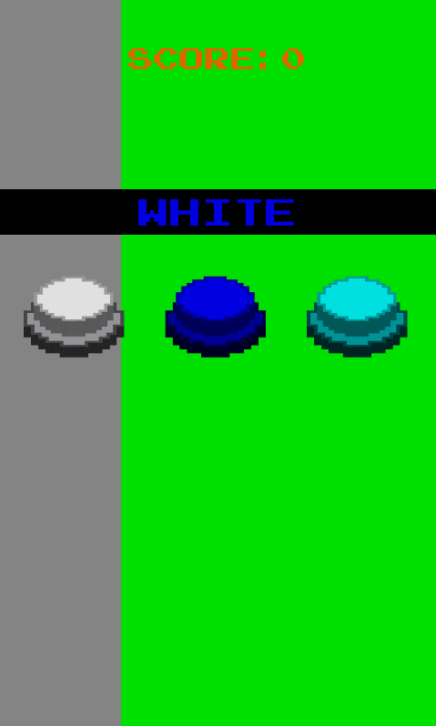
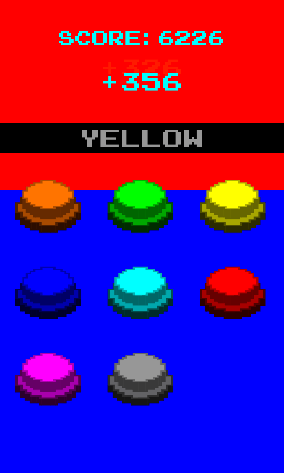

# Rellow

**Il gioco di concentrazione in cui il tuo cervello gioca contro sé stesso.**

### [▶ Gioca ora sul web](https://imaginesoftware.it/rellow-play/)

Gratis, nel browser, su smartphone, tablet e PC. Nessuna installazione, nessuna pubblicità, nessun tracciamento.

<p align="center">
  
  &nbsp;
  
</p>

In alto compare il nome di un colore, e tu devi premere il pulsante di quel colore. La difficoltà: la parola è scritta con un inchiostro di un altro colore. Si parte con tre pulsanti; continuando a vincere arrivano fino a nove, e il tempo per pensare si riduce sempre di più.

La storia completa, compresa la versione nata come allenatore visio-manuale, è sulla [pagina del progetto](https://imaginesoftware.it/open-source-projects/rellow).

## Caratteristiche

- Meccanica basata sull'effetto Stroop
- Difficoltà che cresce su due assi: più pulsanti, meno tempo
- Punteggio che premia velocità e serie di risposte corrette
- Colonna sonora originale
- Grafica in stile pixel art

## Dietro le quinte

- **L'effetto Stroop in due estrazioni.** Il conflitto nasce da due estrazioni casuali indipendenti: una sceglie il nome del colore mostrato, l'altra l'inchiostro con cui è scritto. Vedi [`Game.ts`](Web/src/Game.ts).
- **Una difficoltà su due assi.** Ogni cinque vittorie si aggiunge un pulsante (da 3 a 9, una griglia 3×3) e si tolgono 200 ms al tempo di scelta, da 2,5 secondi fino a un minimo di mezzo secondo. Appena ti abitui, il gioco cambia.

## Tecnologie

La versione web, quella pubblicata, è in [`Web/`](Web): [TypeScript](https://www.typescriptlang.org), [PixiJS 8](https://pixijs.com) per la grafica, [Howler.js](https://howlerjs.com) per l'audio, [Navigo](https://github.com/krasimir/navigo) per le pagine, [Vite](https://vite.dev) per la build.

La cartella [`CSharp/`](CSharp) contiene la versione originale in C# con [MonoGame](https://github.com/MonoGame) e [FbonizziMonoGame](https://github.com/FrancescoBonizzi/FbonizziMonoGame), pubblicata a suo tempo sugli store Android e Windows. Resta come archivio storico e non è più mantenuta.

## Avviarlo in locale

Serve [Node.js](https://nodejs.org) 20.19 o successivo (lo richiede Vite 7).

```bash
cd Web
npm install
npm run dev
```

Il gioco risponde su `http://localhost:5173/rellow-play/`: il percorso coincide con quello di pubblicazione sul sito. `npm run build` produce la versione statica in `Web/dist`.

## Licenza

Codice, grafica e audio sono rilasciati sotto [licenza MIT](LICENSE). I font di terze parti restano sotto le loro licenze: l'elenco è in [`THIRD-PARTY-NOTICES.md`](THIRD-PARTY-NOTICES.md).

Il repository è archiviato: il gioco è concluso e non riceve più sviluppo.

---

Se ti è piaciuto, puoi [offrirmi un espresso](https://www.paypal.com/cgi-bin/webscr?cmd=_donations&business=DTT7P8N3TV7N6&currency_code=EUR&source=url) ☕
